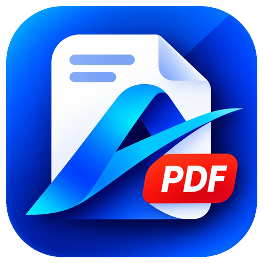

  

<h1 align="center">ArAr PDF Next</h1>

  <b>Aplikasi pembaca, editor, dan ruang kerja PDF Android-native yang cepat, privat, dan 100% offline.</b> 
  A fast, private, 100% offline Android-native PDF reader, editor, and workspace built with Rust + Kotlin Jetpack Compose.

  
  
  
  
  
  

---

## Tentang ArAr PDF Next

**ArAr PDF Next** (`com.ararpdf.next`) adalah aplikasi PDF Android yang menggabungkan **engine PDF berbasis Rust** yang tangguh dengan **antarmuka Android-native berbasis Kotlin & Jetpack Compose (Material 3)** yang dirancang khusus agar nyaman digunakan satu tangan di layar ponsel.

Seluruh pemrosesan dokumen dilakukan **secara lokal di perangkat Anda** — tanpa akun, tanpa iklan, tanpa pelacakan/telemetri, dan tanpa mengunggah dokumen Anda ke server mana pun.

---

## Unduh & Instalasi

Unduh file APK rilis bertanda tangan (*signed release*) langsung dari halaman **[GitHub Releases](https://github.com/gudangjoker/ArArPDF-Next/releases/latest)**:

| File APK | Perangkat Target |
| :--- | :--- |
| **`ArAr-PDF-Next v1.0.1.apk`** | **Direkomendasikan** — Sebagian besar ponsel & tablet Android 64-bit (`arm64-v8a`) |
| **`ArAr-PDF-Next v1.0.1-armeabi-v7a.apk`** | Perangkat Android lama / 32-bit (`armeabi-v7a`) |

- **Persyaratan minimum:** Android 10 (API 29) atau lebih baru.

---

## Fitur Utama

### Antarmuka Android-Native & Tema
- **Desain Material 3 Mobile-First:** Navigasi bawah modern, *Hero Quick-Action Card* (Buka File & Pindai cepat), filter pil, bottom sheet membulat, dan kartu dokumen yang lega di layar ponsel.
- **Mode Terang & Mode Gelap (Light & Dark Mode):** Palet warna biru elektrik & midnight-slate yang serasi dengan logo, lengkap dengan pemilih tema (**Sistem / Terang / Gelap**) di Pengaturan serta tombol ganti tema cepat di Beranda.
- **Mode E-Ink:** Tampilan hitam-putih kontras tinggi tanpa animasi khusus untuk perangkat layar e-paper.
- **Bahasa Indonesia & Inggris:** Lokalisasi **Bahasa Indonesia 100%** dan **Bahasa Inggris** (mengikuti bahasa sistem Android atau pengaturan bahasa per-aplikasi di Android 13+).

### Membaca & Navigasi
- Tampilan halaman **Berkelanjutan**, **Satu halaman**, **Dua halaman**, **Mode Baca (Reflow)**, dan **Mode Malam**.
- Pencarian teks cepat di dalam dokumen dengan penghitung posisi hasil, Daftar Isi (*Table of Contents*), Penanda (*Bookmarks*), Properti Dokumen, serta **Baca Lantang (Read Aloud)** dengan kontrol media di latar belakang.

### Anotasi, Formulir & Edit PDF
- **Anotasi Lengkap:** Sorot (*Highlight*), garis bawah, coret, gambar bebas (*Draw*) dengan *Snap to shape* & penghapus, catatan tempel, serta komentar suara.
- **Edit PDF:** Ubah teks paragraf, atur font/ukuran/perataan/daftar, tambah teks baru, dan sisipkan gambar langsung ke halaman PDF.
- **Isi & Tanda Tangan:** Isi formulir PDF, gambar/sisipkan tanda tangan & paraf, hingga **Tanda Tangan Digital (PKCS#12 / `.p12` / `.pfx`)** beserta verifikasi sertifikat.

### Alat PDF Offline
- **Pindai Dokumen (Scan):** Pindai dokumen kertas dengan kamera, potong otomatis, dan terapkan filter (Warna otomatis, Abu-abu, Papan tulis, dll.).
- **Kenali Teks (OCR Offline):** Model pengenalan teks (`ocrs`) sudah terbundel di dalam aplikasi untuk mengubah halaman pindaian menjadi teks yang bisa dicari & disalin secara offline.
- **Kelola & Konversi:** Gabung file (*Combine*), Atur halaman (urutkan, putar, hapus, sisipkan, ekstrak), Potong halaman (*Crop*), Kompres PDF, Ekspor ke Word/Excel/PowerPoint/RTF/Gambar, Buat PDF dari gambar/teks, serta Lindungi PDF dengan enkripsi kata sandi **AES-256**.

---

## Asal Proyek, Fork & Kredit

Proyek **ArAr PDF Next** berdiri di atas karya luar biasa dari komunitas sumber terbuka. Kami memberikan penghargaan dan kredit penuh kepada proyek asli serta para pengelolanya:

- **Fork Android Asli:** **[artcraft-android/pdfcraft-android](https://github.com/artcraft-android/pdfcraft-android)** oleh **[@artcraft-android](https://github.com/artcraft-android)** dan para kontributornya — sebagai basis aplikasi Android (Kotlin/Jetpack Compose & bridge UniFFI) yang kemudian kami fork dan kembangkan lebih lanjut.
- **Engine PDF Rust Asli:** **[storytold/pdfcraft](https://github.com/storytold/pdfcraft)** oleh **[@storytold](https://github.com/storytold)** dan para kontributornya — yang membangun seluruh engine PDF Rust (`crates/*`) yang tetap kami pertahankan secara utuh di balik ArAr PDF Next.

### Apa yang Dikembangkan di ArAr PDF Next
- Rebranding penuh ke **ArAr PDF Next** (`com.ararpdf.next`) dengan identitas logo baru (launcher, adaptive icon, monochrome Material You Android 13+, dan package installer).
- Perombakan UI/UX agar lebih ramah ponsel Android (Material 3, *edge-to-edge viewer*, judul dokumen di top bar, tombol cepat ganti tema, dan kartu/dialog modern).
- Penambahan sistem tema **Light & Dark** terintegrasi yang mengikuti palet warna logo baru.
- Lokalisasi penuh **Bahasa Indonesia** (`values-in`) berdampingan dengan **Bahasa Inggris**.

---

## Lisensi

Selaras dengan proyek hulu, repositori ini dilisensikan di bawah **MIT OR Apache-2.0**.
Lihat [LICENSE-MIT](LICENSE-MIT), [LICENSE-APACHE](LICENSE-APACHE), [NOTICE](NOTICE), dan [ATTRIBUTION.md](ATTRIBUTION.md) untuk detail lengkap lisensi dan atribusi pustaka pihak ketiga.
